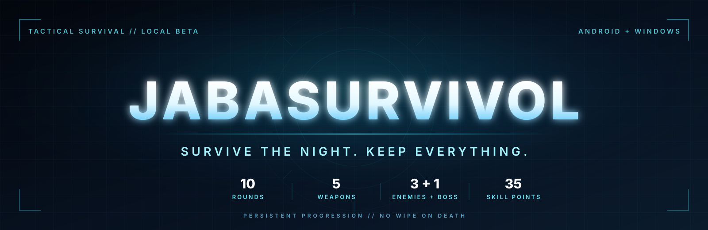
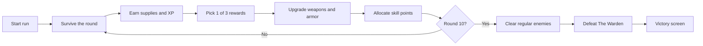
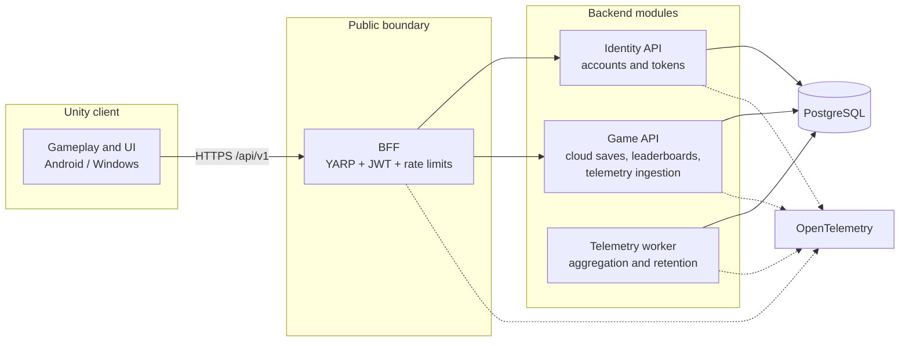

<div align="center">



<br />

[](https://github.com/jb-coder/JabaSurvivol/releases/tag/v0.5.1)
[](#status)
[](#built-for-phones-and-tablets)
[](https://unity.com/)
[](https://dotnet.microsoft.com/)
[](LICENSE)

[](https://github.com/jb-coder/JabaSurvivol/actions/workflows/backend-ci.yml)
[](https://github.com/jb-coder/JabaSurvivol/actions/workflows/unity-tests.yml)
[](https://github.com/jb-coder/JabaSurvivol/actions/workflows/android-build.yml)
[](https://github.com/jb-coder/JabaSurvivol/actions/workflows/security.yml)

### A neon-lit, round-based zombie survival game built for touch.

Fight through ten escalating rounds, build a survivor across runs, and keep every unlock when the night finally wins.

</div>

---

## Contents

- [Status](#status)
- [The pitch](#the-pitch)
- [What you can play today](#what-you-can-play-today)
- [The core loop](#the-core-loop)
- [Arsenal](#arsenal)
- [Enemy roster](#enemy-roster)
- [Progression that respects your time](#progression-that-respects-your-time)
- [Built for phones and tablets](#built-for-phones-and-tablets)
- [Screenshots](#screenshots)
- [Architecture](#architecture)
- [Quality gates](#quality-gates)
- [Quick start](#quick-start)
- [Roadmap](#roadmap)
- [Principles](#principles)
- [Documentation](#documentation)
- [License](#license)

## Status

> **v0.5.1 local beta.** The core loop, persistent progression, five-weapon arsenal, boss encounter, accounts, cloud saves, leaderboard, opt-in telemetry, and BFF are implemented. Visuals are still prototype art, and online features require a reachable backend configured at build time.

Read the [v0.5.1 release notes](docs/releases/2026-11-12-v0.5.1.md) for the full feature list, verification evidence, and known issues.

## The pitch

JabaSurvivol is a single-player, 2D top-down survival game for Android phones and tablets. It combines twin-stick combat with a compact, persistent build system: every run makes the next one stronger, but death still resets the current fight.

The design is deliberately focused:

- One arena.
- One playable character.
- Ten rounds.
- Five weapons.
- Three zombie archetypes plus a boss.
- One clear promise: **death never erases permanent progress.**

## What you can play today

| Feature | What it delivers |
|---|---|
| **Ten-round campaign** | Escalating spawn budgets, health, speed, and damage, ending with a boss at round 10. |
| **Five weapons** | Pistol, SMG, shotgun, rifle, and LMG, each with a distinct range and damage profile. |
| **Permanent weapon upgrades** | Five tiers each for damage, fire rate, magazine size, and reload speed. |
| **Three armor tiers** | Light, medium, and heavy armor, with five permanent upgrade tiers per set. |
| **Nine-node skill tree** | Strength, Agility, and Survival branches, five ranks per node, free respec between runs. |
| **Three active skills** | Turret, Dash, and Shockwave, selected from the armory or character sheet. |
| **Three synergies** | Berserker, Ghost, and Bastion unlock from allocated ranks and add build-defining effects. |
| **Elite rounds** | Round 5 buffs enemies and doubles supplies and XP; round 10 is the boss round. |
| **Boss encounter** | The Warden spawns after the regular round-10 enemies are cleared; the round does not end until the boss dies. The slam is telegraphed, and the boss enrages below half health. |
| **Persistent profile** | Supplies, XP, levels, skill points, unlocks, upgrades, records, and settings survive death. |
| **Touch-first controls** | Landscape twin-stick movement and aiming, with reload, weapon switch, active skill, and pause. |
| **Optional online layer** | Accounts, revision-safe cloud saves, highest-round leaderboard, remote config, and opt-in telemetry. |
| **Local-first resilience** | Local saves with backup recovery, offline play, and explicit cloud-save conflict choices. |

## The core loop



Each round is deterministic from the run seed and round number, so enemy composition and reward choices are reproducible without removing the tension of the fight.

## Arsenal

| Weapon | Role | Unlock |
|---|---|---:|
| **Pistol** | Starting sidearm with infinite reserve | Free |
| **SMG** | Close-range sustained damage | 500 supplies |
| **Shotgun** | Burst damage with a short effective range | 900 supplies |
| **Rifle** | Accurate mid-range damage | 1,200 supplies |
| **LMG** | Sustained suppression | 2,000 supplies |

Weapon unlocks and upgrades are permanent. Ammunition is run-only: magazines, finite reserves, and reload state reset on death or a new run. Ammo crates refill every finite reserve for free and never consume persistent supplies.

## Enemy roster

| Enemy | First seen | Threat | Reward |
|---|---|---|---|
| **Walker** | Round 1 | Baseline health, speed, and contact damage | 10 supplies, 10 XP |
| **Runner** | Round 2 | Faster and more fragile; punishes standing still | 15 supplies, 15 XP |
| **Brute** | Round 4 | High health and contact damage, but slow | 30 supplies, 30 XP |
| **Elite round** | Round 5 | 1.50x health, 1.25x contact damage | 2.00x supplies and XP |
| **The Warden** | Round 10 | 2,400 health, telegraphed slam, enrage below 50% health | 1,000 supplies, 500 XP |

The Warden does not appear until the regular round-10 enemies are cleared. The round stays active until the boss dies.

## Progression that respects your time

### Levels and skill points

- Level cap: **30**.
- **35 skill points** in total: one per level-up, plus one extra at levels 5, 10, 15, 20, 25, and 30.
- Nine nodes, five ranks each, across three branches.
- Free respec between runs.
- Allocation is available from the armory, pause menu, and round-end screen.

### Three branches, three identities

| Branch | Nodes | Build focus |
|---|---|---|
| **Strength** | Strength, Vitality, Shockwave | Damage, health, and area control |
| **Agility** | Speed, Precision, Dash | Mobility, critical hits, and evasion |
| **Survival** | Endurance, Engineering, Turret | Armor, reload and ammo efficiency, deployable firepower |

### Synergies

| Synergy | Requirement | Effect |
|---|---|---|
| **Berserker** | Strength 3 + Vitality 3 | +10% damage below 50% health |
| **Ghost** | Speed 3 + Precision 3 | +10% movement speed for 2 seconds after a kill |
| **Bastion** | Endurance 3 + Engineering 3 | Armor regenerates out of combat |

Synergies are derived from allocated ranks, cost no extra points, and are never stored as purchases.

### What death changes

| Resets with the run | Persists forever |
|---|---|
| Current health | Supplies |
| Current round | XP and character level |
| Position | Skill points and allocated skills |
| Enemies | Weapon unlocks and upgrades |
| Magazines and reserves | Armor unlocks and upgrades |
| Armor condition | Highest round, settings, and schema version |
| Active-skill state | Equipped weapon, armor, and active skill |

## Built for phones and tablets

<div align="center">

**Landscape. Touch-first. Readable at arm's length.**

</div>

- Left virtual stick moves; right virtual stick aims and fires.
- Dedicated buttons for reload, weapon switch, active skill, and pause.
- Auto-fire, aim assist, left-handed layout, joystick size, and joystick opacity options.
- Safe-area support for notches, rounded corners, and tablet layouts.
- Android build: IL2CPP, ARM64, minimum API 26, target API 36.
- Windows build for faster iteration and automated desktop testing.

## Screenshots

<p align="center">
  
</p>

<table>
  <tr>
    <td width="33%"></td>
    <td width="33%"></td>
    <td width="34%"></td>
  </tr>
  <tr>
    <td align="center"><sub>Combat HUD</sub></td>
    <td align="center"><sub>Character sheet</sub></td>
    <td align="center"><sub>Pause menu</sub></td>
  </tr>
</table>

<p align="center"><sub>Development-build screenshots from the v0.4 and v0.5.1 milestones. Gameplay art is still placeholder.</sub></p>

## Architecture



The backend is a modular monolith. Services are extracted only when a concrete need is documented in an architecture decision record.

### Boundaries that keep the game honest

- **`Game.Core` is pure C#.** It owns combat rules, economy, skills, stats, balance, and deterministic spawn composition. It does not reference `UnityEngine`.
- **Unity presents; the core decides.** The client renders, captures touch input, and applies rules from the shared core package.
- **Local play works offline.** Cloud saves are backups with explicit revision conflicts, not a hard dependency for the core loop.
- **Online data is server-mediated.** Identity, cloud saves, leaderboards, and telemetry ingestion live behind the BFF. Cloud saves are backups validated for shape and size, and leaderboard runs are client-reported until server-side simulation is introduced.
- **Tokens stay short-lived.** Access tokens live in memory; refresh tokens use platform encryption and never touch `PlayerPrefs`.
- **Migrations are additive.** Save and database schemas are versioned and backward-compatible.

### Technology stack

| Layer | Technology |
|---|---|
| Game rules | C# in `Game.Core`, shared with Unity as a local UPM package |
| Client | Unity 6.3 LTS, Universal 2D, URP 2D Renderer, Input System |
| Backend | .NET 10, ASP.NET Core minimal APIs, EF Core |
| Data | PostgreSQL |
| Edge | YARP BFF, JWT validation, per-IP and per-account rate limits |
| Observability | OpenTelemetry, health checks, correlation IDs |
| Local orchestration | .NET Aspire AppHost |
| Tests | xUnit, Unity EditMode and PlayMode, Testcontainers |
| CI/CD | GitHub Actions, container scans, Android artifacts |
| Deployment | Docker and Kustomize; the VPS handoff is deferred |

## Quality gates

The v0.5.1 release was verified with:

| Gate | Result |
|---|---|
| Release build | 0 warnings, 0 errors |
| .NET tests | 259 passed: 171 core, 86 integration, 1 architecture, 1 smoke |
| Unity EditMode | 79 passed |
| Unity PlayMode | 86 passed |
| Formatting | `dotnet format --verify-no-changes` passed |
| Android APK | v0.5.1, version code 6, `arm64-v8a`, minimum API 26, target API 36 |
| Device coverage | Android emulator phone and tablet layouts; owner-reported physical-device smoke test |

```powershell
dotnet restore JabaSurvivol.slnx
dotnet build JabaSurvivol.slnx -c Release
dotnet test JabaSurvivol.slnx -c Release
dotnet format JabaSurvivol.slnx --verify-no-changes
```

The balance simulation runs headlessly and writes a deterministic report:

```powershell
dotnet run --project tools/BalanceSimulation/BalanceSimulation.csproj -c Release
```

## Quick start

### Prerequisites

- .NET SDK 10.0.401 or later in the 10.0.4xx band.
- Git and Git LFS.
- Docker Desktop for local containers.
- Unity Hub and Unity 6.3 LTS with Android and Windows build support.
- Android SDK, NDK, OpenJDK, and a physical Android device or tablet for playtesting.

### Build and test the backend

```powershell
dotnet restore JabaSurvivol.slnx
dotnet build JabaSurvivol.slnx -c Release
dotnet test JabaSurvivol.slnx -c Release
```

### Run the local stack

```powershell
dotnet run --project src/AppHost
```

### Open the game

Unity setup instructions, scene details, and Android build steps live in [`docs/setup/unity.md`](docs/setup/unity.md). The latest APK is attached to the [v0.5.1 release](https://github.com/jb-coder/JabaSurvivol/releases/tag/v0.5.1).

## Roadmap

| Milestone | Status | Focus |
|---|---|---|
| **v0.5.1 Local Beta** | Shipped | Core loop, boss, progression, accounts, cloud saves, leaderboards, telemetry, Android beta |
| **v0.5.2 Beta Follow-ups** | Closed | Beta close-out, combat tuning baseline, Android performance baseline, security risk acceptance |
| **v0.6.0 Localization** | In progress | English and Spanish, device-language default, runtime selector, key coverage, and layout checks |
| **v1.0.0 Release and Donations** | Planned | Release readiness and an optional donation link with no in-game rewards |

## Principles

- Persistent progression is sacred. Death resets the run, never the account.
- The player always has a meaningful next upgrade.
- Ammo and armor repairs are free or drop-based.
- No loot boxes, randomized paid rewards, or pay-to-win mechanics.
- No payments or premium currency in the current phase. An optional donation link may be added later and grants no in-game value.
- English is the source language. v0.6.0 adds Spanish with a device-language default and a runtime selector. Every non-English locale, including Spanish, requires human translation review before release; additional locales also require a reviewed ADR.
- Every third-party asset is recorded in `THIRD_PARTY_NOTICES.md`.

## Documentation

| Document | Purpose |
|---|---|
| [`docs/game-design/game-design.md`](docs/game-design/game-design.md) | Core loop, rounds, enemies, boss, controls, and scope |
| [`docs/game-design/economy.md`](docs/game-design/economy.md) | Supplies, XP, weapons, armor, rewards, and pacing |
| [`docs/game-design/skills.md`](docs/game-design/skills.md) | Levels, skill tree, active skills, synergies, and caps |
| [`docs/architecture/README.md`](docs/architecture/README.md) | System shape and architecture decision records |
| [`docs/releases/2026-11-12-v0.5.1.md`](docs/releases/2026-11-12-v0.5.1.md) | Current beta release notes and evidence |
| [`docs/playtests/README.md`](docs/playtests/README.md) | Playtest plans, evidence, and beta feedback templates |
| [`docs/standards/localization.md`](docs/standards/localization.md) | Translation workflow, review gate, and per-locale release checks |
| [`docs/localization/glossary.md`](docs/localization/glossary.md) | Canonical game terms and Spanish terminology |
| [`CHANGELOG.md`](CHANGELOG.md) | Version history |
| [`THIRD_PARTY_NOTICES.md`](THIRD_PARTY_NOTICES.md) | Asset provenance and third-party notices |

Repository layout:

```text
.github/          GitHub workflows, issue forms, PR template
.opencode/        Repository automation, commands, and skills
src/              .NET 10 solution, services, shared core
tests/            Unit, architecture, integration, and smoke tests
unity/            Unity project and local UPM packages
deploy/           Kubernetes, observability, secrets, scripts
infra/            Infrastructure bootstrap and historical scripts
docs/             Standards, ADRs, design, setup, playtests
tools/            Build, bootstrap, balance, and automation scripts
```

## License

Copyright (c) 2026 Javier Baena. All rights reserved.

This repository is proprietary and confidential. No part of it may be copied, modified, distributed, sublicensed, or used without prior written permission. The license is provisional and may change before distribution. See [`LICENSE`](LICENSE).

<div align="center">


<sub>Built with Unity 6.3 LTS, .NET 10, and a persistence-first design.</sub>

</div>
